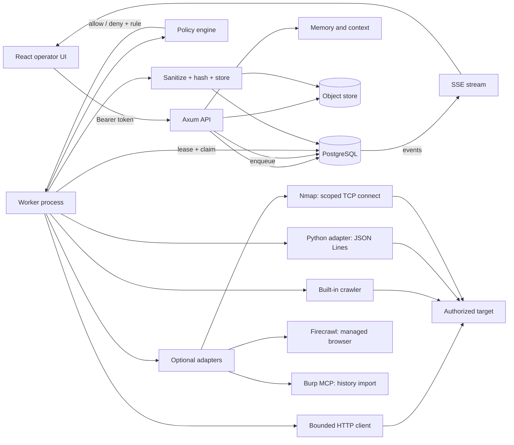
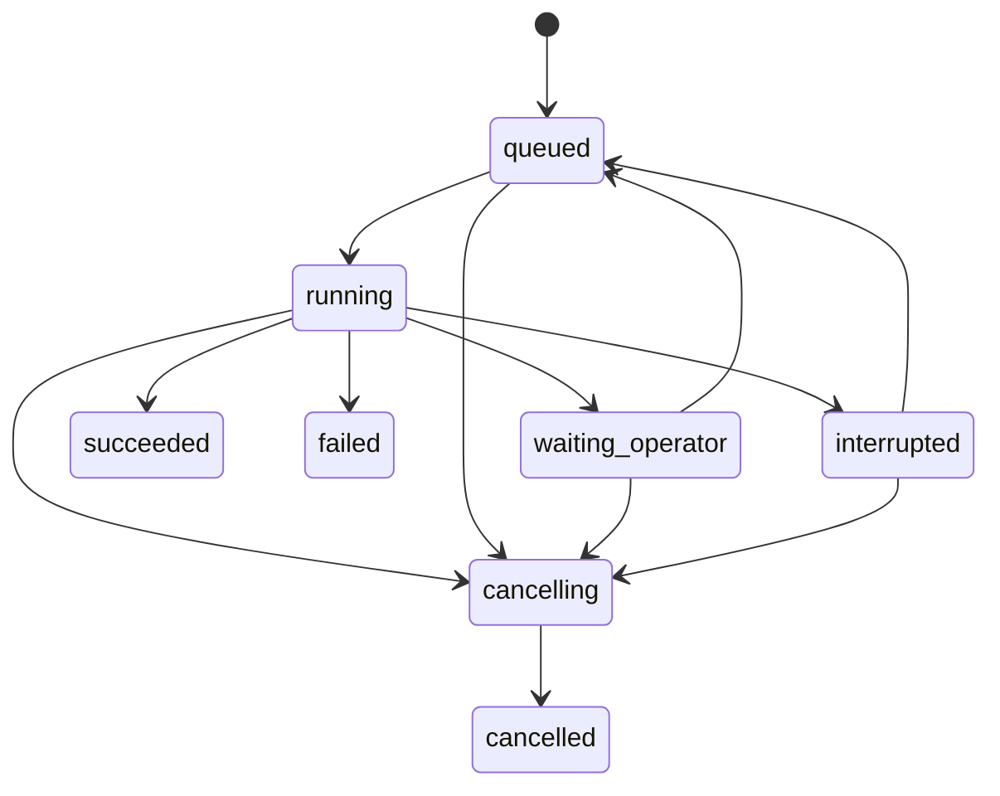

# Architecture

## Shape

DarkBox is a modular monolith plus workers. The API owns authorization and the
read model. The worker owns external operations. Both share the domain, policy,
envelope and storage crates. A Postgres database holds structured records, the
queue, events and narrative memory. A local object store holds evidence bodies.



There is no service per tool. Optional adapters live in `crates/integrations`
and are called by the worker; the browser adapter remains a separate process.
Capability detection decides whether an adapter can run, and the core flow
never depends on an optional tool.

## Crates and dependency direction

```text
contracts  <- domain <- policy
     ^          ^        ^
     |          |        |
  storage -----+--------+
     ^
     |
 evidence   execution   memory   api   cli
```

- `contracts` has no SQL, HTTP or framework types. Identifiers, states, event
  envelopes and DTOs are defined once.
- `domain` contains pure rules: endpoint identity, route grouping, finding
  review transitions, flow blockers. It does not import a web framework or a
  database driver.
- `policy` answers one question: may this request proceed, and which rule
  decided it? It receives resolved addresses from the caller.
- `storage` maps rows into domain structs through `to_jsonb`, so there is one
  model. It also owns the state machine guards that must be transactional.
- `execution` claims a step, re-checks policy, performs the operation, ingests
  evidence and finishes the attempt. It never lets a model select a shell
  command.
- `memory` filters and ranks records, builds a bounded context package, and
  synthesizes a page from references.
- `api` composes the modules. It contains no domain rules beyond
  authorization and request validation.
- `cli` is the operational surface: migrate, seed, serve, worker, procedures,
  purge and verify.

## Data model

Every operational row carries `workspace_id`; assessment-scoped rows also carry
`assessment_id`. This makes cross-workspace rejection a property of each query
rather than a convention in a handler.

The ownership chain is explicit:

```text
Workspace
  Company
    Assessment
      ScopeVersion (immutable policy snapshots)
      Asset
        Endpoint (exact record) + RouteGroup (versioned interpretation)
      TargetTenant
      TestIdentity
        BrowserSession (identity + effective tenant + context key)
      Action -> Flow -> FlowStep
      Run -> RunStep -> StepAttempt
      Observation -> Evidence
      ProcedureDefinition -> TestResult
      Finding -> FindingRevision
      MemoryPage (versioned)
      Event (append-only cursor)
```

`TargetTenant` is a division inside the target application, not a platform
tenant. `TestIdentity` is a configured role, not a login session. A session
fixes one identity and one effective tenant; changing either requires a new
context and does not reclassify history.

### Endpoint identity

`EndpointKey` preserves scheme, lowercase host, effective port, uppercase
method, exact path, parameter names in order, the raw query and the fragment.
The record key includes method, origin, path and parameter names. Values never
enter the key.

A route group replaces whole generated segments (UUIDs, long hex, numeric ids)
with `{id}`. Trailing slashes, encoded separators (`%2F`) and repeated
parameters survive. Grouping is a separate, versioned interpretation; it never
overwrites the exact record.

### States

Run:



`EffectStatus` is independent of run state: `not_dispatched`, `dispatched`,
`confirmed`, `outcome_unknown`, `not_applicable`. A worker that loses its lease
after dispatch cannot write its result. Recovery marks the step
`outcome_unknown`, the run `waiting_operator`, and resume refuses to continue
without explicit reconciliation.

## Scope decisions

The policy is immutable per version. The engine checks, in order:

1. scheme and port;
2. host exclusion;
3. path exclusion;
4. action class;
5. time window;
6. auxiliary destination role;
7. host inclusion;
8. path inclusion;
9. resolved private/link-local addresses;
10. the allow rule is returned with the policy version.

Exclusions prevail. `navigation_dependency` hosts are usable for login and
static assets but are denied as test targets unless also listed in
`test_targets`.

The executor authorizes against two engines: the policy pinned on the run and
the assessment's current policy. Both must allow the request. A later policy
expansion never grants power to an older run.

Redirects are manual. Each hop is resolved, authorized and budgeted before the
next request. That is how the lab proves the excluded listener receives zero
requests.

## Execution

`darkbox worker` (or the API's optional inline worker) claims one step with
`FOR UPDATE SKIP LOCKED`, takes a lease, increments the attempt and runs it.

- `discovery_import` inserts candidates and optionally observes them.
- `discovery_crawler` is a bounded breadth-first crawl. Every request and every
  discovered link is authorized. JavaScript bodies are scanned for quoted
  routes, which is how JS-only pages become candidates.
- `http_observe` performs one bounded request, follows redirects manually and
  stores a sanitized exchange.
- `browser_session` and `browser_flow` call the Python adapter. The adapter
  enforces the same host/port/scheme/path policy for navigation, and receives
  secret references rather than values.
- `procedure_step` dispatches one of the three deterministic procedures.

Budget reservations are a single SQL function with a row lock. Two workers
cannot spend the last unit twice. Duration is checked before dispatch.
Cancellation marks pending steps skipped, stops claiming, and the supervisor
kills the adapter process group when cooperative cancellation fails.

Evidence is written through a temporary file and renamed, keyed by an opaque
id. Sanitization removes sensitive headers, bearer tokens, session cookies,
password-like fields and the synthetic secret marker before hashing and
storage. The stored document is explicitly derived, not a byte-identical copy.

## Events

Every state change inserts an event row in the same transaction as the state
change. The envelope carries `event_id`, `schema_version`, workspace,
assessment, run, step, type, both timestamps, correlation id and validated
payload. SSE polls by monotonic `seq` and resumes with `after`. Consumers
de-duplicate by `event_id`. Ordering is guaranteed per run, not globally.

This is a transactional outbox in the pragmatic sense: a change is not
committed without its event. It is not full event sourcing.

## Memory and context

Canonical sources:

| Layer | Source | Derived |
| --- | --- | --- |
| Inventory | structured records and observations | read projections |
| Evidence | sanitized object + integrity metadata | previews and manifests |
| Narrative | versioned `memory_pages` | search index and Markdown export |

`ContextBuilder` filters by workspace and assessment before ranking, applies an
identity filter to flows, estimates tokens, includes only references (never
evidence bodies), and records what it omitted. A worker writes a checkpoint
page for every terminal run. Synthesis is deterministic by default; an
OpenAI-compatible provider is used only when `DARKBOX_MODEL_SYNTHESIS=1` and a
key is configured. Model text is labelled derived and never edits evidence.

## Interface

The UI reads only the API. It has no mock data path. The shell keeps the
assessment context visible, the inventory is a dense filterable table, run
detail streams events and separates "cancellation requested" from "cancelled",
and evidence renders as inert text. Scope preview shows the rule and policy
version for each decision.

## Failure behaviour

| Failure | Behaviour |
| --- | --- |
| Worker dies before dispatch | lease expires, step returns to pending |
| Worker dies after dispatch | step `outcome_unknown`, run waits for operator |
| Duplicate ingestion | idempotent evidence ids and unique endpoint keys |
| Budget race | atomic reservation fails one caller |
| Cancellation | pending steps skipped; new claims refused; adapter group killed |
| Scope revoked mid-run | next authorization fails with the current rule |
| Adapter crash or oversized output | structured failure, process group killed |
| Database restart | confirmed rows and leases survive; queued work resumes |
| Lost evidence object | metadata remains, content access returns 404; export marks missing |
